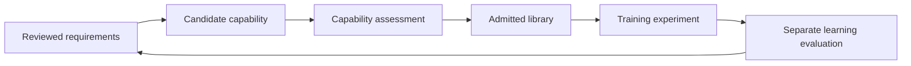

# VeriExpand · Research Experiment Summary

**论文实验的精简展示仓库 / A minimal companion for ongoing paper experiments.**

本项目用于介绍我们正在开展的学生作答环境与模型学习研究。公开内容包括研究问题、实验边界和独立编写的微型代码示例。它不是完整论文复现包，也不是可用于批改真实作业的系统。

## Research question

How can reviewed student work guide improvements to a synthetic learning environment, and when do those improvements actually help a grader?

We study two connected loops:

- **Environment loop:** examine reviewed requirements and assess candidate capabilities for possible reuse.
- **Learning loop:** practice within an admitted environment and evaluate a training recipe separately.

A reusable capability and a better trained model are different outcomes. A capability can be retained even when a particular training recipe does not improve the grader.



This diagram describes research intent; it does not claim a fully validated end-to-end system.

## What you can run

Python 3.9+; no packages, credentials, network access or model downloads required.

```bash
python3 examples/decision_summary.py
python3 -m unittest discover -s tests -v
```

The example summarizes **invented decisions supplied as input**. It does not calculate scientific evidence, verify geometry, train a model or reproduce our experiments. All output is explicitly marked fictional.

## Current evidence boundary

Exploratory comparisons of sampling strategies have been conducted. They have not established an advantage for adaptive sampling over uniform resampling. Those experiments do not establish the effectiveness of capability expansion or transfer to real student work. Additional controlled comparisons and independently reviewed evaluation remain necessary.

This repository makes no claim of a submitted, accepted or published paper. There is no public paper identifier associated with this release.

## Public scope

| Included | Not distributed |
| --- | --- |
| High-level research questions | Core environment and geometry implementation |
| Original, fictional decision-summary example | Training, synthesis and data-cleaning pipelines |
| Tests for the example's bookkeeping | Prompts, real student work, annotations and model outputs |
| Explicit limitations | Weights, internal configurations, experiment logs and full manuscript |

See [research scope](docs/research_scope.md) and [release boundary](SECURITY.md).

## 中文说明

我们将“能力是否可以入库”和“当前训练方案是否值得采用”分开讨论。这里的程序只演示如何记录这两类结论，核心算法和真实数据没有公开。示例中的检查值均为虚构输入，不能作为论文实验结果引用。

公开版保留探索性研究的限制，不把合成开发集结果写成真实场景收益，也不把 AI 标注直接当作人工真值。完整实验尚在完善中。
